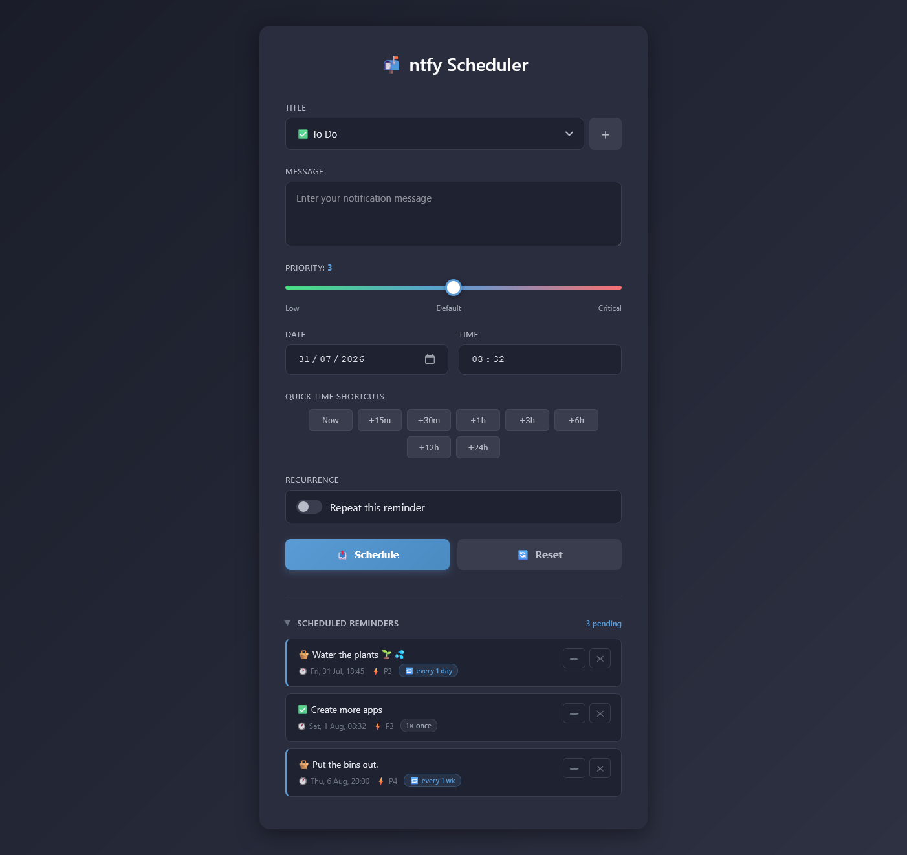

# ntfy Reminders

A self-hosted reminder app for [ntfy](https://ntfy.sh) with support for one-time and recurring reminders. Reminders are persisted to a local JSON file and dispatched via cron (or the bundled Docker image), so they survive server restarts and updates.

## Screenshot


## Structure

```
ntfy-reminders/
├── ntfy_server.py             Flask server — serves the UI and exposes the REST API
├── ntfy_dispatch.py           Cron script — fires due reminders, reschedules recurring ones
├── ntfy_schedule.py           Schedule maths shared by both — stepping a repeat forward, the weekday filter
├── ntfy_store.py              File lock and atomic write shared by both — keeps reminders.json intact
├── static/
│   └── ntfy.html              Web UI — schedule, edit, and delete reminders; manage titles + emoji
├── standalone/
│   ├── ntfy-client-only.html  No server needed — open directly in a browser; no recurring reminders
│   └── ntfy-client-demo.html  Demo version that allows ntfy.sh topic to be entered on screen. 
├── data/                      Auto-created at runtime, gitignored
│   ├── reminders.json         All pending (and recently-fired) reminders
│   └── titles.json            Your list of titles and their linked emoji
├── docs/
│   └── screenshot.png
├── tests/                     Unit tests — python -m unittest discover -s tests
│   └── ci_smoke.py            End-to-end check of the container, run by CI
├── Dockerfile                 Container image (see Docker below)
├── docker-entrypoint.sh       Starts the dispatcher loop, then the web server
├── docker-compose.yml
├── .env                       Your config — topic, base URL, and optional extras (see below)
├── .env.example
└── requirements.txt
```

## Requirements

- Python 3.8+
- Ubuntu (or any Linux with cron)
- or Docker, which needs neither — see [Docker](#docker)

## Setup

```bash
# Clone the repo
git clone https://github.com/shanemc92/ntfy-reminders.git
cd ntfy-reminders

# Create and activate a virtual environment
python3 -m venv venv
source venv/bin/activate

# Install dependencies
pip install -r requirements.txt
```

## Configuration

Copy `.env.example` to `.env` and fill in your values:

```bash
cp .env.example .env
```

```dotenv
NTFY_BASE_URL=https://ntfy.sh
NTFY_TOPIC=your_topic_here

# Seeds titles.json the first time the server runs — after that, manage
# titles (add/rename/delete, and link an emoji to each) from the app itself.
NTFY_TITLES=To Do,Web Link,Housework

# Address the server binds to. Defaults to 127.0.0.1 (loopback only).
BIND_HOST=127.0.0.1

# LAN address of this app, used to build the notification's "Reschedule" action button.
# Leave blank to disable that button.
NTFY_REMINDERS_URL=http://your-server:5000

# Optional PNG shown as the notification icon
NTFY_ICON_URL=http://your-server:5000/static/icon.png
```

`.env` is gitignored — never commit it. Since the topic is your only access control on the public `ntfy.sh` relay, use a long, hard-to-guess one (or self-host ntfy).

### Binding

The server binds to `127.0.0.1` by default, so out of the box it is only
reachable from the machine it runs on. Set `BIND_HOST` in `.env` to widen that:

```dotenv
BIND_HOST=0.0.0.0
```

Only do that once a firewall rule limits port 5000 to your reverse proxy. The
app has no login of its own, so anything that can reach the port can read and
change your reminders.

## Security notes

- **There is no app-level login.** Authentication is the reverse proxy's job
  (forward auth, a VPN, whatever you put in front of it). Keep `BIND_HOST` on
  loopback unless a firewall rule restricts the port to that proxy.
- **No CSRF tokens, and none are needed.** Every state-changing route
  (`POST /titles`, `PUT /titles/<idx>`, `DELETE /titles/<idx>`,
  `POST /schedule`, `PUT /reminders/<id>`, `DELETE /reminders/<id>`) reads its
  body with `request.get_json()` and never passes `force=True`, so Flask
  rejects anything that does not arrive as `application/json`. An HTML form on
  another site cannot send that content type, and a cross-origin `fetch` that
  does has to pass a CORS preflight first, which this server never answers.
  No route accepts form-encoded data. If one ever does, it will need a token.
- **The ntfy topic is your only access control on the public relay.** Use a
  long, hard-to-guess topic name, or self-host ntfy.

## Running the Server

```bash
source venv/bin/activate
python3 ntfy_server.py
```

Then open `http://localhost:5000` in your browser.

To pick up code or `.env` changes, restart it: `Ctrl+C` then re-run, or `sudo systemctl restart ntfy-reminders` if you've set it up as a service (see below). The cron-run dispatcher doesn't need restarting — it re-reads `.env` and `reminders.json` fresh every run.

## Cron Setup

Run `crontab -e` and add these two lines (adjust paths):

```
* * * * * /path/to/venv/bin/python3 /path/to/ntfy_dispatch.py >> /path/to/ntfy.log 2>&1
@reboot   /path/to/venv/bin/python3 /path/to/ntfy_server.py  >> /path/to/ntfy.log 2>&1 &
```

The dispatcher runs every minute and checks for due reminders. The `@reboot` line restarts the server automatically after a reboot.

### Optional: systemd (more robust)

```ini
# /etc/systemd/system/ntfy-reminders.service
[Unit]
Description=ntfy Reminders
After=network.target

[Service]
ExecStart=/path/to/venv/bin/python3 /path/to/ntfy_server.py
Restart=on-failure
User=youruser

[Install]
WantedBy=multi-user.target
```

```bash
sudo systemctl enable ntfy-reminders
sudo systemctl start ntfy-reminders
```

## Docker

A multi-arch image (`linux/amd64`, `linux/arm64`) is published to the GitHub Container Registry:

```
ghcr.io/shanemc92/ntfy-reminders
```

Tags: `latest` (the `main` branch), `1.2.3` / `1.2` / `1` for releases, and the short commit SHA.

One container runs both halves: the web server (gunicorn) and the dispatcher, which a background loop in
`docker-entrypoint.sh` runs at the top of every minute. The cron job above is not needed. The container
refuses to start if `NTFY_TOPIC` is not set.

### Compose

```bash
cp .env.example .env      # set NTFY_TOPIC, and TZ (see below)
docker compose up -d
```

Then open `http://localhost:5000`. To update: `docker compose pull && docker compose up -d`. To build the
image from this checkout instead of pulling it: `docker compose up -d --build`.

### docker run

```bash
docker run -d --name ntfy-reminders --restart unless-stopped \
  --env-file .env \
  -v ntfy-reminders-data:/app/data \
  -p 127.0.0.1:5000:5000 \
  ghcr.io/shanemc92/ntfy-reminders:latest
```

### Things to know

- **Settings** come from `.env` (`--env-file` takes values literally, so leave them unquoted).
  `BIND_HOST` has no effect in the container; the published port decides who can reach it. Both examples
  publish on `127.0.0.1` only, for the reason in [Security notes](#security-notes) — keep it that way
  unless a reverse proxy that authenticates sits in front.
- **Data** lives in `/app/data` (`reminders.json`, `titles.json`). Mount a volume there or reminders are
  lost when the container is replaced. A bind mount must be writable by uid 1000 (`chown -R 1000:1000 ./data`,
  the directory as well as the files in it), because the container does not run as root. If it isn't, the
  container logs a warning at start; saving keeps working through the existing files but not atomically,
  and if `reminders.json` itself can't be written the dispatcher refuses to send rather than repeat
  every reminder every minute.
- **Timezone**: set `TZ` (for example `TZ=Europe/London` in `.env`). It defaults to UTC, which is what
  monthly repeats and the weekday filter's fallback use. Weekday filters saved from the browser carry
  their own zone and are not affected.
- **One web worker.** That is plenty for a personal list. Saves are safe either way: the server and the
  dispatcher lock the data files around each change and replace them atomically, so editing a reminder
  while a dispatch run is sending, or stopping the container mid-run, cannot lose or corrupt reminders.
- **Maintainers:** the `docker` workflow builds and smoke-tests the image on every push and pull request,
  and publishes from `main` and from `v*.*.*` tags. After the first publish, check the package is set to
  public under the repository's *Packages* settings if you want unauthenticated pulls.

## Features

- Schedule one-time reminders at a specific date and time
- Schedule recurring reminders (every N hours / days / weeks / months)
- Limit hourly and daily repeats to chosen days with an M T W T F S S row of toggle buttons —
  e.g. a daily reminder on workdays only, or weekends only. Excluded days are skipped without
  shifting the schedule, and a first fire that lands on an excluded day moves to the next allowed
  one. Weekdays are read in the timezone of the browser that saved the reminder, so a server in UTC
  doesn't put a late-night or early-morning reminder on the wrong day (this needs Python 3.9+;
  on 3.8 the server's timezone is used instead). Weekly and monthly repeats don't have the buttons:
  they already land on one fixed day
- Titles are managed in-app (add, rename, delete) and each can have an emoji linked to it,
  picked from a curated set based on [ntfy's supported emoji](https://docs.ntfy.sh/emojis/) —
  sent as the notification's `Tags` header rather than embedded in the title, since ntfy's
  `Title` header only accepts Latin-1 text
- Edit any pending reminder — reloads it into the form
- Delete reminders
- Reschedule directly from the notification: tap the "Reschedule" action button to reopen
  the app with that reminder loaded, ready to pick a new time. One-time reminders are kept
  for 24 hours after firing so this still works after the fact; recurring reminders are
  cloned into a fresh one-off so their regular schedule isn't disturbed
- Quick, cumulative time shortcuts (1h, 3h, 9h, 12h, 18h, 24h, 36h) — each click adds to
  whatever's currently in the date/time fields
- Priority slider (1–5)
- Collapsible "Scheduled Reminders" list (collapsed by default)
- Reminders persist across server restarts — ntfy never holds the schedule
- A reminder that can't be sent (ntfy unreachable, a network blip) stays due and is retried every
  minute for up to 6 hours, rather than being dropped; a recurring one keeps its slot. After that it
  gives up and moves on to its next occurrence. Retries show as `[FAILED]` lines in the log
- Editing, adding or deleting reminders while the dispatcher is mid-run is safe: each side takes a
  file lock (`reminders.json.lock`) and writes atomically, so neither overwrites the other

